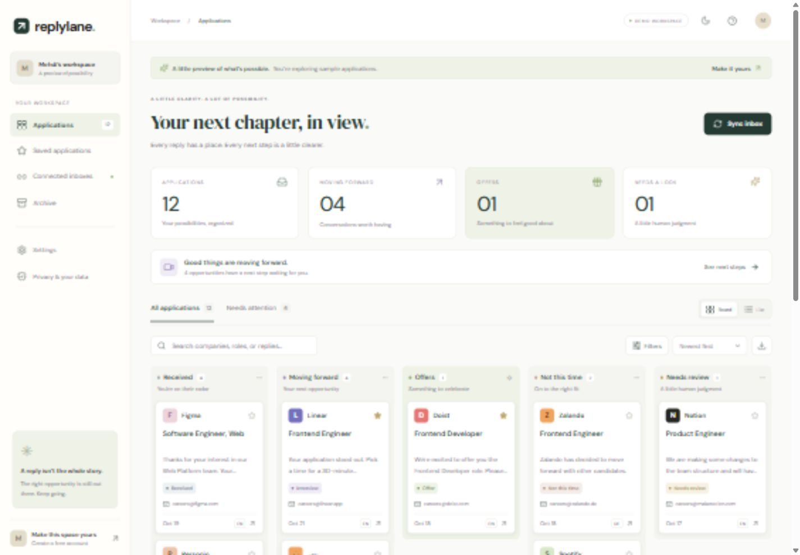
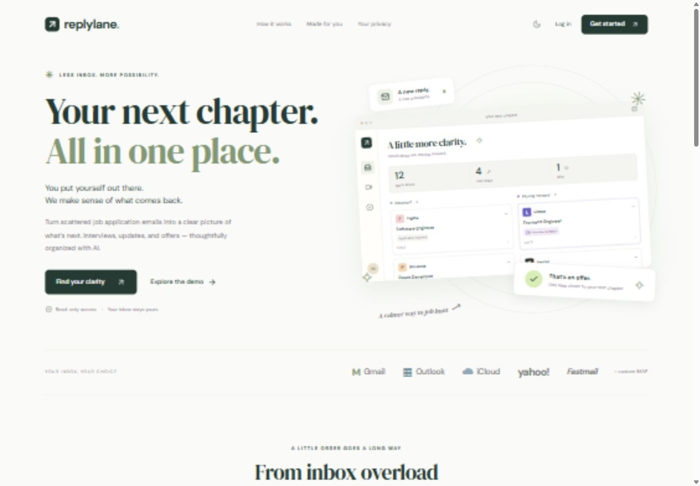
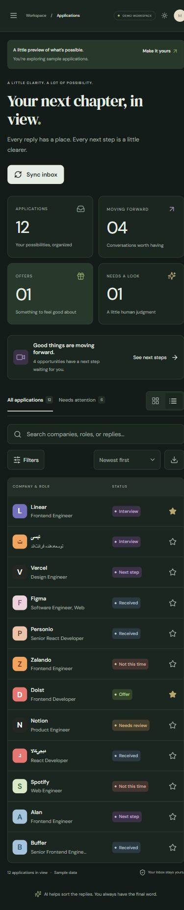

# Replylane

Organize job application emails into a clear, searchable pipeline.

Replylane finds replies from employers, summarizes what happened, and keeps each application’s latest status and next step in one workspace. Connect an inbox, review the results, and get an optional Telegram alert when a new reply is processed.

## Preview

<p align="center">
  
</p>

<p align="center">
  
  
</p>

## What it does

- Connect Gmail or Microsoft 365 with OAuth, or connect an IMAP mailbox such as iCloud, Yahoo, Fastmail, or a custom domain.
- Import a single `.eml` file or choose a recent date range for mailbox history.
- Group employer replies into application cards and organize them by status, including moving forward, offers, rejected, and needs review.
- Read original messages alongside concise summaries and suggested next steps, with Persian and other multilingual replies supported.
- Search, filter, save, annotate, set deadlines, archive, restore, and move unwanted cards to Trash.
- Receive optional Telegram notifications for newly processed replies.
- Use the responsive board or list view, with light and dark themes.

Mailbox access is read-only. Replylane does not send, move, delete, or mark messages as read. Attachments are not submitted for classification. Message text is shortened and recognized email addresses and links are redacted before it is sent to the configured processing provider; redaction may not catch every personal detail. See the [privacy notice](src/app/privacy/page.tsx) and [setup guide](docs/SETUP.md) before connecting real accounts.

## Run locally

Requirements: Node.js 22.21 or later and npm.

```sh
npm ci
npm run dev
```

Create `.env.local` from `.env.example` and configure the required services before signing in or connecting a mailbox. Open [http://localhost:3000](http://localhost:3000) to start. See [docs/SETUP.md](docs/SETUP.md) for Firebase, classification-provider, mailbox, Telegram, and deployment configuration. Keep `.env.local` private; it is excluded from Git.

## Checks

```sh
npm run typecheck
npm test
npm run build
```

`npm run check` runs all three. The optional `npm run evaluate:ai` sends synthetic sample emails to the configured provider and uses its API allowance; it is separate from the offline test suite.

## Project notes

- [Architecture](docs/ARCHITECTURE.md) — sync flow, storage, and failure handling.
- [Setup](docs/SETUP.md) — local services and deployment configuration.
- [Verification](docs/VERIFICATION.md) — checks performed and areas that need a live staging environment.
- [Classification research](docs/AI-RESEARCH.md) — provider and model evaluation notes.

The scheduled worker checks mail periodically, so alerts are not real time. Backfills resume from saved checkpoints and may pause when provider or usage limits are reached. Live OAuth consent, IMAP servers, scheduled deployment, and classification quality should be tested with a staging account before opening the service to other users.

## License

MIT. See [LICENSE](LICENSE).
