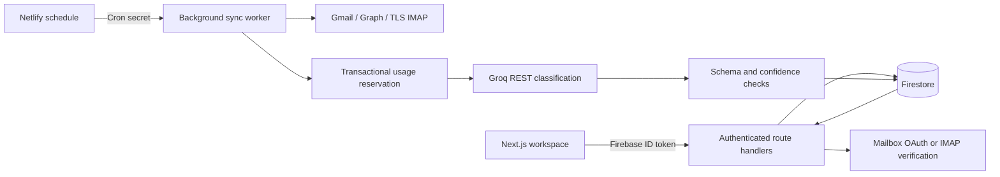

# Inside Replylane

The browser owns presentation. Mail access, credentials, classification, and persistence stay on the server.



## State ownership

TanStack Query holds server data and refreshes the workspace every 30 seconds while open. Patches invalidate that query. Zustand persists only the theme, board/list preference, and demo records. Live email records are not persisted by Zustand. React Hook Form handles account forms; Zod validates server inputs and model output.

Live routes use Firebase Admin to verify the ID token, check revocation and verified email, and derive the owner ID. The browser never supplies an authoritative owner ID. Firestore’s direct client rules deny access, including to connection credentials.

The `/app` shell is a public page containing no private data. Authentication gates every data endpoint. A redirect in client UI is convenience, not the access-control boundary.

## Collections

```text
users/{uid}
  applications/{hash(connectionId + threadId)}
    events/{hash(messageId)}
  receipts/{hash(connectionId + messageId)}
  usage/{UTC-day}

connections/{hash(uid + provider + email)}
aiUsage/{UTC-day}
system/aiThrottle
rateLimits/{hash(uid + action)}
```

Connections are a top-level collection so the scheduler can find due work without listing every user. API responses pick safe connection fields explicitly. The encrypted secret, owner ID, lock, and provider cursor are not returned to the browser.

Application IDs group a provider conversation. That grouping prevents ordinary reply chains from producing separate cards. It is not semantic matching across different threads or mailboxes. For IMAP/email imports, MIME References/In-Reply-To form the thread key when available.

## Connection lifecycle

OAuth start requires an authenticated, verified account and consent. It creates random state and a PKCE verifier in an encrypted HttpOnly, SameSite=Lax cookie with a ten-minute lifetime. The callback compares state, validates scope, exchanges the code, checks account state, and encrypts the refresh token. The callback clears the cookie on success or failure.

IMAP accepts a preset or a custom public hostname. It resolves and validates addresses, pins a checked answer for the socket, requires TLS with certificate validation on port 993, verifies login, and opens Inbox read-only. The saved password is AES-256-GCM encrypted with account/connection context as authenticated data. This prevents moving ciphertext between users or connections.

The mailbox software does not make modifying IMAP calls. An app password itself may have broader provider permissions, so users should revoke it at their provider when finished.

## Import and incremental checks

Each connection stores its creation time and chosen boundary: now, 30 days earlier, or 60 days earlier. There are independent live and history cursors. A connection with no import uses only the live cursor. While importing, successful passes alternate between the two so recent replies are not blocked by the backlog.

Gmail uses paginated, bounded time-window queries. Graph uses paginated received-date windows across the user’s messages, filtering self-sent messages. Both use an overlap of up to two minutes between completed live windows to tolerate small indexing delays. They do not implement Gmail history or Graph delta subscriptions in this version. A message that becomes searchable later than the overlap can be missed; a future reconciliation job or provider-native delta/push integration would improve that edge.

IMAP tracks UIDVALIDITY and the highest checkpointed UID. A UIDVALIDITY change starts a bounded re-scan; delivery receipts use stable Message-ID/content identity to avoid reclassification when server UIDs change. Each page fetches up to six messages.

Each provider page contains up to six messages. A leased pass classifies eligible messages in one batch and checkpoints only after all in-range messages have receipts. A partial page is fetched again, but processed messages do not call the classifier again. Provider or model failure leaves the cursor unchanged. Receipt lookups run together, and obvious service mail and bulk digests are filtered before model use.

The scheduled dispatcher runs every minute. Its secret-protected background worker runs for a bounded four-minute window, processing up to twelve messages per invocation. It selects the earliest due active connections. Provider limits, per-account allowance, and retries can stop it earlier. The open workspace also advances due work while visible.

## Writes and concurrency

A Firestore transaction grants a four-minute connection lease with a random lock ID. A second caller cannot use an active lease. Final state updates check that lock ID. Pause state is preserved if the user pauses while a request is running.

Result persistence checks the account and connection again. A disconnected mailbox or deleting account cannot receive a late saved result. The same transaction writes the delivery receipt, relevant event, and latest application state. An old imported response can add history but cannot replace newer application details.

Manual status, notes, saved/archive state, and existing deadline are preserved on later replies. The most recent AI status is retained separately, so the drawer can explain the difference. A saved manual status remains in effect until the user changes it again.

There is still an unavoidable boundary between an external AI request and a database commit. A process crash after inference but before the receipt can cause that request to be repeated. The saved application remains idempotent; inference is not claimed to be exactly once.

## Data retention and deletion

Unrelated message content is discarded after classification; only its processing receipt remains. Relevant cards and events contain bounded excerpts. Attachments are not stored or displayed. Browser-rendered text is escaped by React; email HTML is never injected into the page.

Disconnect removes the stored connection and credential, preserving cards for reference. It does not revoke the provider’s grant automatically. Account deletion first marks a tombstone, removes connections and per-action rate-limit records, deletes user subcollections, then removes Firebase Auth and the user document. A recent sign-in is required. Shared aggregate usage counters remain without an email address or user ID.

The current deletion route is synchronous. An unusually large workspace can exceed hosting duration limits and need another attempt or an operator-driven cleanup. A production-scale service should make this a separately monitored deletion job.

## Verification boundaries

Offline tests use synthetic mail and an in-memory transaction double. They cover contracts, state transitions, and failure behavior, not actual Firestore isolation or email-server interoperability. The opt-in model evaluation calls Groq with synthetic fixtures. Real mailbox and deployed scheduler checks are required in staging before public use.
